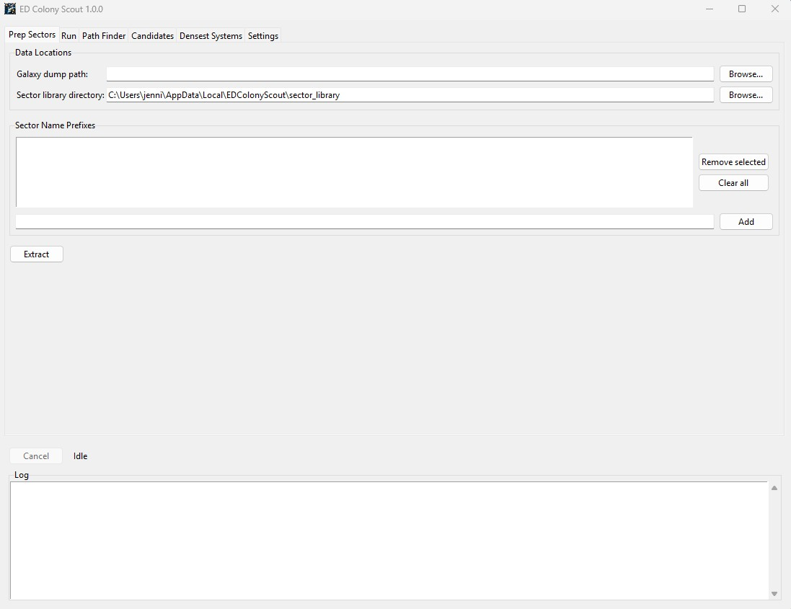
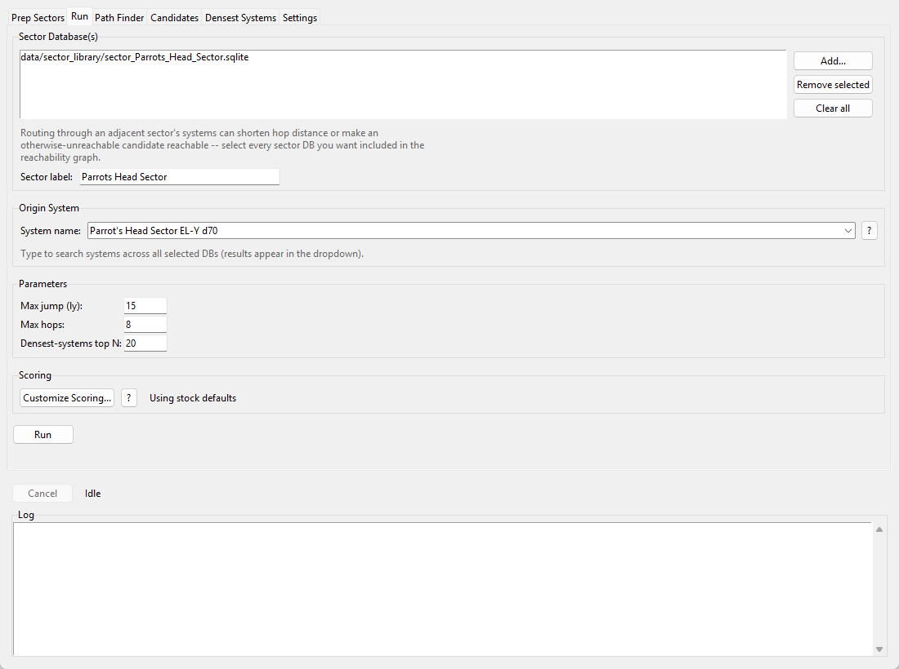
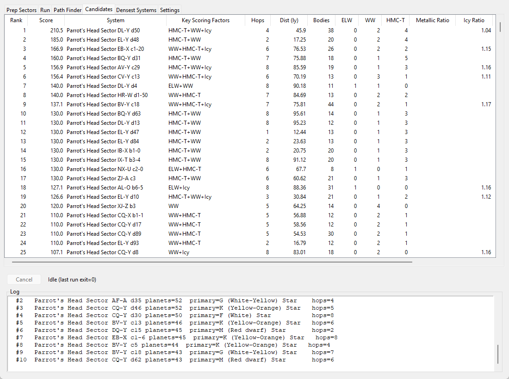
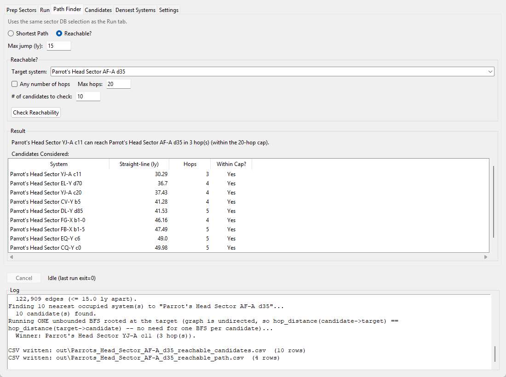

# ED Colony Scout


Colonization-planning tooling for Elite Dangerous: given an already-extracted
sector of the galaxy, rank nearby systems by colonization value, chart the
actual jump-chain path between two systems, and check whether a target
system can be reached — and claimed — from an already-inhabited launch
point within a given number of hops.

Everything runs entirely offline against a local SQLite extraction of a
[Spansh](https://spansh.co.uk/dumps) galaxy dump. No network calls of any
kind — see [Data privacy](#data-privacy) below.



## What it does

- **Prep Sectors** — extract one or more named sectors from a full Spansh
  galaxy dump into local SQLite databases, in a single pass over the dump.
- **Run** — pick one or more extracted sector databases and an origin system
  (typically your own colony), and rank every reachable, colonization-eligible
  system by a transparent, user-editable scoring rubric.
- **Path Finder** — two focused queries built on the same reachability graph:
  - **Shortest Path**: the true shortest hop-chain route between any two
    named systems.
  - **Reachable?**: given a target system, checks the nearest
    already-occupied systems and reports whether (and from where, and in how
    many hops) a colony claim on that target is actually launchable.
- **Candidates** / **Densest Systems** — sortable result tables: colonization
  candidates ranked by score, and the reachable systems with the most
  planetary bodies. Double-click any system name in these tables (or in
  Path Finder's results) to open a **System Detail** popup — see below.

## Installation (end users)

If you just want to run the app rather than work with the scripts directly:

1. Download the latest installer (`ED-Colony-Scout-Setup-X.Y.Z.exe`) from
   this repo's [Releases](../../releases) page and run it. It installs
   per-user (no admin rights needed) and adds a Desktop/Start Menu
   shortcut. Since the installer and app aren't code-signed, Windows
   SmartScreen (and possibly your antivirus) will treat it with suspicion
   the first time — see
   [Antivirus and SmartScreen warnings](#antivirus-and-smartscreen-warnings)
   below before you download, so you know what to expect and how to verify
   the file.
2. Launch **ED Colony Scout** from the Desktop shortcut and follow
   [Getting started](#getting-started) below.

Building from source instead (for development, or to build your own
installer) is covered in [Installation (running from source)](#installation-running-from-source)
and [Building a release](#building-a-release) below.

## Installation (running from source)

```bash
git clone <this repo>
cd ed-colony-scout
pip install -r requirements.txt
python -m gui.main
```

Requires **Python 3.10+** (the codebase uses `from __future__ import
annotations` and PEP 604-style unions throughout).

## Antivirus and SmartScreen warnings — what to expect and what to do

ED Colony Scout is a small open-source tool. Its releases are currently
**not code-signed** (code-signing certificates are expensive and reputation
takes time to build), so Windows and some antivirus products will treat the
installer with suspicion the first time they see it. **This is expected and
does not mean anything is wrong with the file** — it means Windows has never
seen this exact file before and no publisher identity is attached to it.
You can (and should) verify the download yourself; instructions below.

### First: verify your download

Every release on the [Releases](../../releases) page lists a SHA-256
checksum for the installer. After downloading, open PowerShell and run:

    Get-FileHash .\ED-Colony-Scout-Setup-X.Y.Z.exe -Algorithm SHA256

If the hash printed matches the one in the release notes, your file is
byte-for-byte the one the maintainer published, and the warnings below are
safe to click through. If it does **not** match, delete the file and
re-download from the Releases page only — never from a third-party mirror.

### "Windows protected your PC" (SmartScreen) — blue dialog

This appears because the installer is new and unsigned, not because
anything harmful was detected. If your checksum matched:

1. Click **More info**.
2. Click **Run anyway**.

That's it — SmartScreen only gates the first run.

### Your antivirus flags, quarantines, or deletes the file

Some antivirus products go further than a warning and quarantine the
installer or the installed `ED Colony Scout.exe`. This is a **false
positive** with a known cause: the app is packaged with PyInstaller (a
standard tool that bundles a Python program and the Python runtime into an
exe), and because some actual malware is also built with PyInstaller, a few
antivirus engines flag *everything* built with it. See PyInstaller's own
[note on antivirus false positives](https://github.com/pyinstaller/pyinstaller/blob/develop/.github/ISSUE_TEMPLATE/antivirus.md).

If this happens:

1. **Verify the checksum first** (above). Only proceed if it matches.
2. **Restore the file from quarantine** using your AV's quarantine/history
   screen (the wording varies: "Restore", "Allow", "Not a threat").
3. **Add an exclusion** so it doesn't recur — either for the installer
   file, or (after installing) for the app folder:
   `%LOCALAPPDATA%\Programs\EDColonyScout`
   In Windows Security this is under: Virus & threat protection →
   Manage settings → Exclusions → Add or remove exclusions.
4. Optionally, **report the false positive** to your AV vendor — this
   genuinely helps: enough reports get the file whitelisted for everyone.

**Never add exclusions for files whose checksum you haven't verified.**
The verify-then-restore order matters: the checksum is what tells you the
flagged file really is the one published here.

### v1.0.0 VirusTotal scan

The v1.0.0 installer was scanned on VirusTotal before release:
[full report](https://www.virustotal.com/gui/file/4eabec8a9c05b0da9fefbd5cd644a6f604317959f91235a8bc23be9145e51764).

**5 of 71 engines flagged it, and none of them are mainstream consumer
antivirus products** — Windows Defender, Kaspersky, ESET, Sophos,
BitDefender, Avast, AVG, Malwarebytes, Symantec, and TrendMicro all report
it clean. The three named detections (Arctic Wolf, SecureAge, Trapmine) use
generic labels (`obfuscated/poly`) rather than identifying a known malware
family, and the associated Sigma rule matches are explainable: one fires on
*any* new executable being created, and another ("Python Image Load By
Non-Python Process") exists specifically to flag PyInstaller/py2exe/
cx_Freeze-bundled executables in general — exactly the false-positive
pattern described above, not something specific to this app's behavior.

SHA-256 of the scanned file (`ED-Colony-Scout-Setup-1.0.0.exe`):

    4EABEC8A9C05B0DA9FEFBD5CD644A6F604317959F91235A8BC23BE9145E51764

Each release gets its own checksum (see
[First: verify your download](#first-verify-your-download) above) and
ideally its own scan; this section reflects v1.0.0 specifically and will be
updated (or superseded by a per-release note) as new versions ship.

### Why not just sign the releases?

Code signing is a possible future improvement (e.g. via
[SignPath Foundation](https://signpath.org/), which offers free signing for
qualifying open-source projects) but isn't in place yet. Until then,
checksums + this documentation are the interim answer. If a release is ever
signed, this section will be updated.

## Getting started



1. **Prep Sectors tab** — set a galaxy dump path (a full Spansh
   `galaxy.json.gz` — the **all-systems** dump, not the "populated systems
   only" one; see [Source data](#source-data-the-galaxy-dump)) and a sector
   library directory, add one or more sector name prefixes (e.g.
   `Parrots Head Sector`), and hit **Extract**. This streams the dump once
   and writes one SQLite database per sector.
2. **Run tab** — add the extracted sector database(s) you want included,
   pick an origin system (normally your existing colony), set the jump/hop
   parameters, and hit **Run**. Results land in the Candidates and Densest
   Systems tabs.
3. **Path Finder tab** — once you've spotted a promising candidate, use
   **Shortest Path** to chart the actual route to it, or **Reachable?** to
   check whether it can be claimed at all given where the nearest inhabited
   systems actually are.

Selecting **multiple** sector databases on the Run tab merges them into one
reachability graph before anything else runs — routing through an adjacent
sector's systems can shorten a hop chain or make an otherwise-unreachable
candidate reachable, and this is the only way to see that. The Path Finder
tab reuses whichever databases are currently selected on the Run tab, rather
than picking them again.

## Reachability model

"Reachable within N hops" means a *chain* of jumps, each within
**Max Jump (ly)** of the *previous* system in the chain — not a single
radius drawn around the origin. This mirrors how colonization bridging
actually works in-game: a sequence of short hops can reach much farther than
any single jump. Uninhabited systems are valid waypoints in that chain; they
just aren't valid *colonization targets* themselves unless they're also
eligible (see below).

Internally this is a grid-bucketed spatial adjacency graph (cell size = max
jump distance, checking the 27 neighboring cells of each system) followed by
a breadth-first search from the origin, capped at **Max Hops**. The graph is
undirected, which the Path Finder tab's **Reachable?** mode exploits: rather
than running a separate search per candidate launch point, it runs one
search rooted at the target and reads every candidate's hop distance from
that single result.

## Colonization eligibility

A system is a valid colonization target only if it has **no established
government** — i.e. it isn't already claimed by a faction. This is a fixed
game-mechanic rule, not a scoring preference, and it isn't editable. Occupied
systems still function as hop-through waypoints when building the
reachability graph (you can route *through* an inhabited system on the way
to somewhere else); they're simply excluded from the ranked Candidates and
Densest Systems output, since you can't found a new colony there.

## Scoring

Every reachable, colonization-eligible system earns points across five
categories; **Score** is the sum. The default ("stock") point values:

| Category | First tier | Beyond first tier |
|---|---|---|
| Earth-like World | first 2 @ 100 pts each | 50 pts each |
| Water World | first 2 @ 40 pts each | 20 pts each |
| Terraformable High Metal Content World | first 3 @ 30 pts each | 15 pts each |
| Metallic ring (see below) | 30 base pts | scaled by density |
| Icy ring (see below) | 25 base pts | scaled by density |

**Rings**: only a system's single densest ring *per class* counts, and only
if its surface density (mass ÷ ring cross-sectional area) is at or above the
galactic median for that class — 8.591068 × 10⁻⁶ kg/m² for Icy,
9.251326 × 10⁻⁶ kg/m² for Metallic. A qualifying ring's score is
`base_points × (1 + (density_ratio − 1) × 0.5)`, so denser rings score more
within the same base.

**None of this is a black box.** Every point value and tier size above (11
fields total: three tier sizes and eight point values) is editable via the
Run tab's **Customize Scoring...** dialog, with a **?** button next to it
that always shows the exact values currently in effect. The ring density
floor, the ring bonus curve's `0.5` slope, and the galactic median density
constants stay fixed — they're properties of how the median itself is
computed, not preferences — and the occupied-system exclusion rule (above)
is likewise fixed and documented in the same help text rather than a silent
filter. The **Candidates** table's **Key Scoring Factors** column names
which categories actually contributed to each system's score (e.g.
`ELW+WW+Icy`), ordered by point contribution.



## Path Finder

Both modes on this tab operate on whichever sector database(s) are currently
selected on the Run tab.

**Shortest Path** — enter an origin and a target system name; reports the
hop count and the full system-by-system route (including any uninhabited
waypoints), via an unbounded breadth-first search. A hop cap doesn't apply
here: a shortest path either exists in the loaded, connected data or it
doesn't.

**Reachable?** — enter a target system, a hop cap (or check **Any number of
hops**), and how many nearby occupied systems to check (default 10). Since
claiming a new colony requires launching from an *already-inhabited* system
within jump range — not necessarily your own colony — this finds the
nearest occupied systems to the target by straight-line distance, then
determines which of them (if any) reaches it within the hop cap, reporting
whichever one does so in the fewest hops. If none qualify, it reports the
**closest miss**: the nearest-by-hops candidate anyway, and by how many hops
it falls short, rather than a bare "not reachable."

Both modes also write their results to CSV in the configured output
directory (Settings tab), in addition to populating the tables in the GUI.



## System Detail popup

Double-click any system name — in Candidates, Densest Systems, or either of
the Path Finder result tables — to open a read-only breakdown of that
system: every stellar and planetary body, which ones are landable, their
terraform state, biosignal/geosignal counts (with cleaned-up biological
genus names where the dump reports them), and every ring with its class and
mass/radius. It reads directly from whichever sector database(s) are
currently selected on the Run tab, so if that selection has changed since a
result was generated, you'll get a "not found" message instead of stale or
mismatched data.

## Source data: the galaxy dump

Nothing in this repo ships with system data. You need a local copy of a full
[Spansh](https://spansh.co.uk/dumps) galaxy dump — the **all-systems** dump,
not "populated systems only"; the reachability graph needs uninhabited
systems too, since they're valid hop-through waypoints. This is a large file
(tens to over a hundred GB compressed); the Prep Sectors tab streams it once
regardless of how many sector prefixes you extract in that pass.

## Command-line usage

Every pipeline stage is also a standalone script, useful for scripting or
for exercising the underlying engine directly without the GUI:

```bash
# Extract one or more sectors from a galaxy dump in a single pass
python scripts/extract_multi_sector_to_sqlite.py \
    --input "/path/to/galaxy.json.gz" \
    --sector_prefix "Parrots Head Sector"

# Rank colonization candidates reachable from an origin (repeat --db to merge sectors)
python scripts/colonization_reachability_export.py \
    --db data/sector_library/sector_Parrots_Head_Sector.sqlite \
    --sector "Parrots Head Sector" \
    --origin-system "Parrot's Head Sector EL-Y d70" \
    --max-jump-ly 15 --max-hops 8 --out-dir out

# Shortest hop-chain path between two named systems
python scripts/path_finder_export.py \
    --db data/sector_library/sector_Parrots_Head_Sector.sqlite \
    shortest-path --origin-system "Parrot's Head Sector EL-Y d70" \
    --target-system "Parrot's Head Sector AF-A d35" --max-jump-ly 15 --out-dir out

# Is a target reachable from a nearby occupied system within a hop cap?
python scripts/path_finder_export.py \
    --db data/sector_library/sector_Parrots_Head_Sector.sqlite \
    reachable --target-system "Parrot's Head Sector AF-A d35" \
    --max-jump-ly 15 --max-hops 20 --candidates 10 --out-dir out
```

The CLI entry points always use the stock scoring rubric (customization is a
GUI-only feature at present) and write the same CSV outputs the GUI loads
into its tables.

## Dependencies

`pip install -r requirements.txt`.

- **Python 3.10+**.
- **`ijson`** — required by `scripts/extract_sector_systems_to_sqlite.py` to
  stream a Spansh galaxy dump that's a JSON-array document (rather than JSON
  Lines) without loading the whole file into memory. Performance depends
  heavily on backend — check with `python -c "import ijson; print(ijson.backend)"`;
  the compiled `yajl2_c` backend is dramatically faster than the pure-Python
  fallback.
- Everything else (`sqlite3`, `csv`, `json`, `argparse`, `tkinter`, `dataclasses`, ...)
  is standard library.

## Building a release

Packaging is manual (no CI currently builds releases automatically outside
of a tag push — see `.github/workflows/release.yml`) — from a Windows
machine with [Inno Setup](https://jrsoftware.org/isinfo.php) installed
(`iscc` on PATH):

```bash
pip install -r requirements.txt
pip install -r requirements-build.txt
powershell -File packaging/build.ps1
```

This runs both steps in order — `pyinstaller packaging/ed_colony_scout.spec
--clean` (producing the `dist/ED Colony Scout/` onedir build) then `iscc
packaging/installer.iss` (wrapping it into
`dist-installer/ED-Colony-Scout-Setup-X.Y.Z.exe`) — and prints the
installer's SHA-256 checksum at the end, ready to paste into the release
notes. Bump `MyAppVersion` in `packaging/installer.iss` **and**
`filevers`/`prodvers`/`FileVersion`/`ProductVersion` in
`packaging/version_info.txt` **and** `gui/config.py`'s `APP_VERSION`
together before building a new release.

Neither `dist/` nor `dist-installer/` are committed to git (see
`.gitignore`) — attach the built installer `.exe` to a new GitHub Release
instead; it's a compiled binary and doesn't belong in git history. Pushing
a `v*` tag triggers `.github/workflows/release.yml`, which builds and
publishes the installer (with its checksum) automatically, gated on the
test suite passing.

## Repository layout

```
scripts/
  extract_sector_systems_to_sqlite.py   Single-sector extraction from a galaxy dump
  extract_multi_sector_to_sqlite.py     Multi-sector extraction in one pass over the dump
  colonization_reachability_export.py   Reachability graph, scoring rubric, candidate ranking engine
  path_finder_export.py                 Shortest Path / Reachable? engine (reuses the above)

gui/
  app.py            Tkinter window: Prep Sectors, Run, Path Finder, Candidates, Densest Systems, Settings tabs
  worker.py         Background-thread job runner (stdout capture, cooperative cancellation)
  pipeline.py       Orchestrates scripts/ calls for the GUI, relays results back via a sentinel-line convention
  db_lookup.py      Read-only sqlite helpers backing the DB/origin/target pickers and System Detail popup
  system_detail.py  The System Detail popup (double-click a system name in any results table)
  rubric.py         Scoring-rubric config<->dataclass round-trip, help text, and the customization dialog
  treeview_utils.py Generic sortable-Treeview + CSV/dict-loading helpers for the results tables
  config.py         Persisted settings (%APPDATA%\EDColonyScout\config.json)
  main.py           Entry point (`python -m gui.main`, and the PyInstaller build target)

tests/               Automated test suite (stdlib unittest) against a small fixture sector
packaging/           PyInstaller spec, Inno Setup installer script, icon, version resource, build script

data/sector_library/   Extracted per-sector SQLite DBs (gitignored)
out/                   Generated CSV reports (gitignored)
```

## Data privacy

This program makes **no network calls of any kind**. Every pipeline stage —
extraction, scoring, reachability, path-finding — reads only from a local
galaxy dump file and locally-extracted SQLite databases you supply. Nothing
is ever sent anywhere.

## Caveats

- Extracted data is only as fresh as the galaxy dump it came from — Spansh
  dumps are periodic snapshots, and the actual game state (who's colonized
  what) changes continuously. Re-extract periodically if you're tracking a
  fast-moving region.
- Scoring is a planning aid, not a guarantee — it reflects the point values
  configured at run time, applied to whatever the source dump reported.
- The occupied-system exclusion relies on the dump correctly reporting a
  system's government/allegiance at the time it was captured; a system
  claimed very recently might not yet be reflected.

## Acknowledgments

This project exists only because of data and infrastructure built and
maintained by others, freely made available to the community:

- **[Spansh](https://spansh.co.uk/)**, created and maintained by **Gareth
  Harper** — the galaxy dumps this project's entire extraction pipeline is
  built on.
- **[EDDN](https://eddn.edcd.io/)** (Elite Dangerous Data Network) and the
  wider **[EDCD](https://github.com/EDCD)** community — the real-time,
  crowdsourced data network Spansh and the broader third-party tool
  ecosystem are ultimately built on top of.
- The Elite Dangerous commander community at large — every system this
  project's analysis is built on exists because a player chose to explore
  it and *voluntarily* submit that discovery through an EDDN-compatible
  tool.

## Legal

*Elite Dangerous* is a trademark and copyright of **Frontier Developments
plc**, all rights reserved. This is an unofficial, fan-made tool built by a
player of the game; it is not affiliated with, endorsed by, or sponsored by
Frontier Developments in any way. All Elite Dangerous game data, names, and
imagery referenced here are the property of Frontier Developments plc — see
their fan content policy (on their website) for the terms this project
operates under.
